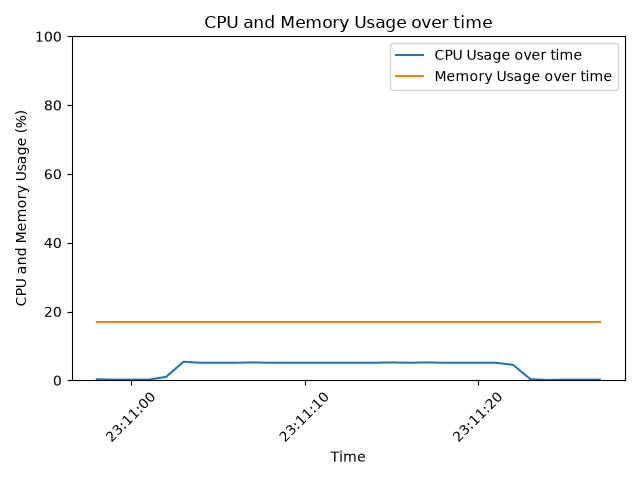

# Linux System Performance & Diagnostics Tool

A small Python toolkit that monitors CPU and memory utilization on Linux, logs timestamped measurements to CSV, and analyzes and plots the results. It also includes an [MCP](https://modelcontextprotocol.io) server and a Claude Code Skill so an AI assistant can collect and interpret the same measurements.

## Overview

The tool samples system-wide CPU and memory usage once per second through [psutil](https://github.com/giampaolo/psutil), which reads the same kernel interfaces (`/proc`) used by tools like `top` and `free`. Measurements are written to a CSV file, summarized with basic statistics, and plotted over time.

I built it to learn how the operating system exposes hardware resource usage to software, and how to collect, validate and interpret performance measurements. It measures **software-visible utilization only**: it does not perform hardware, thermal or physical diagnostics.

## Features

- **`cpu_monitor.py`**
  - Prints a system snapshot: logical CPU count, available memory, OS, kernel release and Python version.
  - Logs CPU %, memory %, and available/total/used memory (GiB) to `system_metrics.csv` every second.
  - Warns in the terminal when CPU or memory usage reaches or exceeds a configurable threshold.
  - Validates threshold arguments: rejects non-numeric values, values outside 0–100, `nan` and `inf`.
  - Stops cleanly with Ctrl-C.
- **`analyze_metrics.py`**: reports average and maximum CPU usage, average and maximum memory usage, and minimum available memory.
- **`plot_metrics.py`**: plots CPU and memory usage over time to `metrics.png`. Works without a display (headless).
- **`mcp_server.py`**: an MCP server (stdio transport) exposing three read-only tools to AI clients such as Claude Code. See [AI Access via MCP](#ai-access-via-mcp-claude-code).
- **`.claude/skills/hardware-diagnostics/SKILL.md`**: a Claude Code Skill that tells Claude how to use those tools and how to report results cautiously.

Both the analyzer and the plotter exit with an error message and exit code 1 if the CSV is missing.

## Requirements

- Linux (developed on Ubuntu 24.04.5 LTS)
- Python 3.12
- psutil 7.2.2
- matplotlib 3.11.2
- mcp (MCP Python SDK) 1.30.0, for the MCP server only

## Setup

```bash
git clone https://github.com/michaelluaustin/Hardware-Diagnostic-Tool.git
cd Hardware-Diagnostic-Tool
python3 -m venv .venv
source .venv/bin/activate
pip install -r requirements.txt
```

## Usage

Run all commands from the project folder.

```bash
# Start monitoring (default thresholds: CPU 60%, memory 70%); stop with Ctrl-C
python cpu_monitor.py

# Custom warning thresholds
python cpu_monitor.py --cpu-threshold 80 --memory-threshold 90

# Summarize the recorded run
python analyze_metrics.py

# Plot the recorded run to metrics.png
python plot_metrics.py
```

## AI Access via MCP (Claude Code)

`mcp_server.py` uses the MCP Python SDK (`FastMCP`) to expose the monitoring logic as tools an AI assistant can call. It runs locally over **stdio**: the client starts it as a subprocess and exchanges JSON-RPC messages through stdin/stdout. It opens no network port and runs no shell commands.

### Tools

| Tool | Arguments | Returns |
|---|---|---|
| `get_system_info` | none | OS, kernel release, architecture, processor name, logical and physical CPU counts, total RAM |
| `get_current_metrics` | none | Timestamp, CPU % (averaged over 1 second), memory %, used and available RAM, and a note that temperature and physical health are not measured |
| `monitor_resources` | `duration_seconds` (1–60, default 10), `interval_seconds` (1–10, default 1), `cpu_threshold` (0–100, default 85), `memory_threshold` (0–100, default 90) | Sample count, requested and actual duration, average and peak CPU/memory, number of samples at or above each threshold, CSV path, and a cautious interpretation |

- `monitor_resources` takes `duration_seconds // interval_seconds` samples (e.g. 10 s every 3 s gives 3 samples), so it always finishes within 60 seconds.
- Each run is saved to `data/monitor_YYYYMMDD_HHMMSS.csv` with the same columns as `system_metrics.csv`. The `data/` folder is created automatically and is ignored by git.
- Invalid arguments (out of range, `interval_seconds` greater than `duration_seconds`, `nan`/`inf`, booleans, strings, fractional seconds) are rejected with an error message instead of running.
- If the CSV cannot be written, the summary is still returned with `csv_path: null` and a `csv_error` message.

### Register the server with Claude Code

The server is registered at project scope in `.mcp.json`, which Claude Code reads when it starts in this folder. The paths must be absolute and point to your own `.venv` Python, so `.mcp.json` is ignored by git and each machine creates its own. To create it from the project folder:

```bash
claude mcp add --scope project hardware-diagnostics -- \
  "$PWD/.venv/bin/python" "$PWD/mcp_server.py"
```

Or copy `.mcp.json.example` to `.mcp.json` and replace `/path/to/Hardware-Diagnostic-Tool` with the absolute path of your clone. Either way the result looks like:

```json
{
  "mcpServers": {
    "hardware-diagnostics": {
      "type": "stdio",
      "command": "/path/to/Hardware-Diagnostic-Tool/.venv/bin/python",
      "args": ["/path/to/Hardware-Diagnostic-Tool/mcp_server.py"],
      "env": {}
    }
  }
}
```

Then start Claude Code with this folder as the working directory (in VS Code: **File → Open Folder** on the project, then open a new Claude Code session). Approve the `hardware-diagnostics` server when prompted, and check it with `/mcp` or `claude mcp list`.

### Use the Skill

The Skill at `.claude/skills/hardware-diagnostics/SKILL.md` is loaded automatically for sessions started in this folder. It tells Claude to identify the system first, take a baseline, monitor only for a bounded time, separate measurements from hypotheses, recommend follow-up tests, and state the tool's limitations. Never infer hardware failure from utilization. Invoke it directly with `/hardware-diagnostics`, or ask a question such as "Is my CPU or memory under heavy load right now?"

## Example Results

Test machine: Intel Core i5-14600 (14 cores: 6 performance cores with Hyper-Threading and 8 efficiency cores, for 20 logical CPUs), 31.04 GiB RAM.

I compared an idle run with a run under a controlled CPU workload. While the monitor was running, I started this single-threaded Python busy loop in a second terminal. It increments a counter as fast as possible for 20 seconds and then exits on its own:

```python
import time
end = time.time() + 20
x = 0
while time.time() < end:
    x += 1
print("Workload finished")
```

| Metric | Idle (18 s) | Workload (30 s, ~20 s under load) |
|---|---|---|
| Average CPU usage | 0.17% | 3.50% |
| Maximum CPU usage | 0.30% | 5.40% |
| Memory usage | 17.1% | 17.0% |
| Minimum memory available | 25.73 GiB | 25.75 GiB |



**Observations**

- During the workload, CPU usage held steady at about 5.1%. That is what one fully busy logical CPU looks like on this machine: 100% ÷ 20 logical CPUs = 5%. System-wide CPU percentage can therefore hide a single saturated core.
- Memory usage barely changed between runs.
- `Memory Used + Memory Available` does not add up to `Memory Total`. Linux counts reclaimable page cache as available but not as used.

## Testing

The tool was manually tested on Ubuntu 24.04.5 LTS using Python 3.12.

| Test | Expected result | Outcome |
|---|---|---|
| Valid CPU and memory thresholds | Accepted and monitoring starts | Passed |
| Threshold above 100 or below 0 | Rejected with an argument error | Passed |
| Non-numeric threshold input | Rejected with an argument error | Passed |
| `nan`, `inf`, or `-inf` threshold | Rejected with an argument error | Passed (`nan` was initially accepted; fixed) |
| CSV analysis with valid data | Correct averages, maximums, and minimum available memory are reported | Passed |
| Empty CSV containing only headers | Informative message is printed without a calculation error | Passed |
| Analysis or plotting with no CSV file present | Error message is printed and the script exits with code 1 | Passed |
| Monitoring interrupted with Ctrl+C | Monitoring stops gracefully and recorded data remains saved | Passed |
| Plot generation from valid CSV data | CPU and memory usage graph is saved as a PNG | Passed |
| Controlled CPU workload compared with idle run | Average and maximum CPU usage increase during the workload | Observed as expected |

Testing was performed manually; no automated test suite has been added. Results may vary depending on system activity and whether the environment is virtualized.

### MCP server

The MCP server was tested with Python 3.12.3, mcp 1.30.0 and psutil 7.2.2. These tests were run during development but are not included in the repository.

| Test | Expected result | Outcome |
|---|---|---|
| Syntax check of all scripts (`py_compile`) | No errors | Passed |
| Argument validation: bounds, out-of-range values, `nan`/`inf`, booleans, strings, interval greater than duration | Valid values accepted; invalid values rejected with a clear message | Passed |
| Summary calculations: averages, peaks, value equal to threshold counts as a violation, empty input | Correct values; empty input rejected | Passed |
| CSV output: header and rows, `data/` created automatically, two runs in the same second | Same columns as `cpu_monitor.py`; second file gets a suffix instead of overwriting | Passed |
| CSV write failure (simulated `PermissionError`) | Summary still returned with `csv_path: null` and `csv_error` | Passed |
| Real stdio session using the SDK client: list tools, call all three tools, call with invalid arguments | 3 tools listed; valid calls succeed; invalid calls return `isError: true` | Passed |
| `claude mcp list` after registration | Server listed (pending approval until approved in Claude Code) | Passed |

To check the server yourself:

```bash
# Syntax check
.venv/bin/python -m py_compile mcp_server.py

# List the registered tools without starting a client
.venv/bin/python -c "import asyncio, mcp_server; print([t.name for t in asyncio.run(mcp_server.mcp.list_tools())])"

# Check that Claude Code sees the server
claude mcp list
```

The MCP Inspector (`mcp dev mcp_server.py`) can also be used for interactive testing. It requires Node.js with `npx` and opens a web UI on localhost.

## Limitations

- **System-wide averages only.** A single saturated core shows up as about 5% CPU, so the default 60% threshold would not flag it. Per-core monitoring would be needed for that.
- **1-second sampling.** Each row is a 1-second average, so shorter spikes are smoothed out. Timestamps mark the start of each sample window, have 1-second resolution, and drift slightly over long runs.
- **Virtualized environments.** In a VM, CPU usage is relative to the guest's virtual CPUs, and time taken by the host is not visible.
- **Data is saved reliably only on Ctrl-C.** Writes are buffered, so killing the process (for example with `kill`) can leave an empty or incomplete CSV.
- **The analyzer assumes a well-formed CSV.** Blank or truncated rows cause it to crash.
- **Each run overwrites** `system_metrics.csv` and `metrics.png`.
- **Warnings go to the terminal only.** They print every second while over the threshold and are not recorded in the CSV.
- **The monitor's own overhead** is included in the measurements, although it is very small.
- **Files are read and written in the current working directory**, so the scripts should be run from the project folder.

**MCP server**

- **Same measurements, same limits.** The MCP tools report software-visible CPU and memory utilization only. They do not measure temperatures, voltages, fan speeds, electrical signals, disk health, or the physical condition of any component, and high utilization alone does not indicate a hardware fault.
- **Bounded runs only.** `monitor_resources` runs for at most 60 seconds, so it cannot capture long-term trends.
- **Timestamps differ from `cpu_monitor.py`.** In `data/` CSVs, each timestamp marks the end of its sample window.
- **Machine-specific configuration.** `.mcp.json` needs absolute paths, so it is not committed; each machine registers the server with its own paths (see `.mcp.json.example`).
- **Interpretation depends on the AI client.** The tool returns cautious text and the Skill sets reporting rules, but the assistant's final answer should still be checked against the raw numbers.
